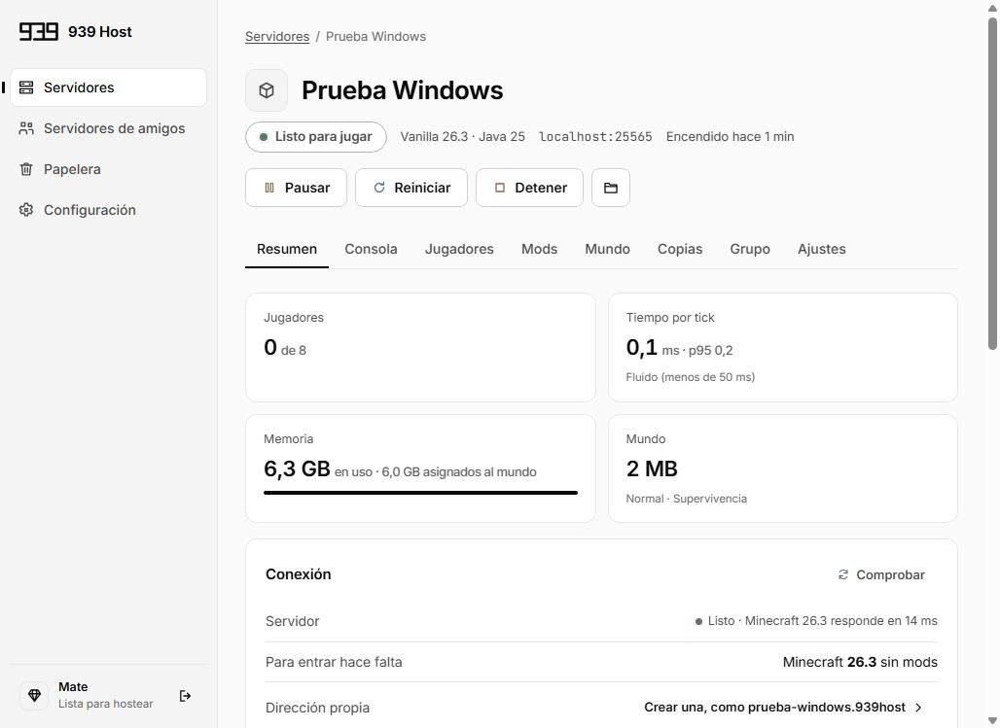
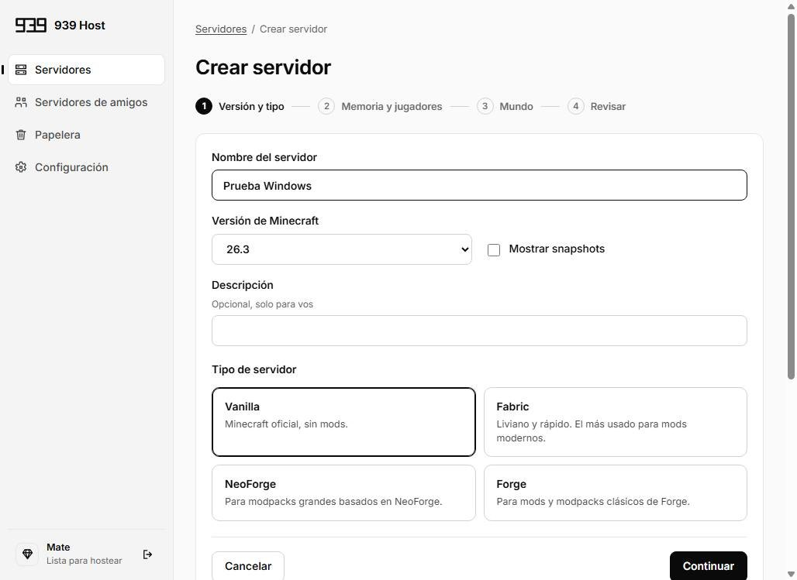
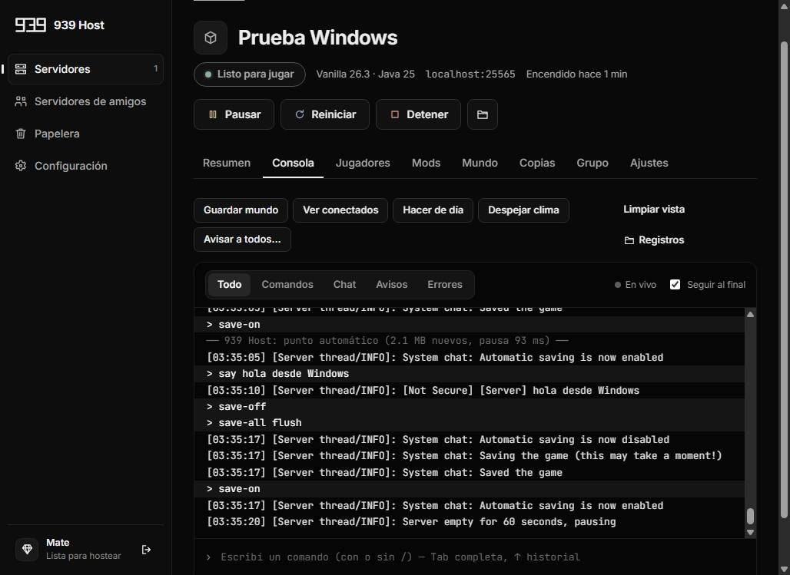

  <picture>
    <source media="(prefers-color-scheme: dark)" srcset="docs/img/939-oscuro.svg">
    
  </picture>

<h1 align="center">939 Host</h1>

  Servidores de Minecraft Java para jugar con amigos, alojados en sus propias PCs. 
  Sin hosting pago, sin abrir puertos y sin una PC que tenga que estar siempre encendida.

  <a href="https://github.com/bouthex/939-host/releases/latest"><b>Descargar para Windows</b></a>
  &nbsp;·&nbsp; <a href="docs/MANUAL.md">Manual</a>
  &nbsp;·&nbsp; <a href="docs/PROBLEMAS.md">Ayuda</a>
  &nbsp;·&nbsp; <a href="CHANGELOG.md">Cambios</a>

  <picture>
    <source media="(prefers-color-scheme: dark)" srcset="docs/img/servidor-oscuro.jpg">
    
  </picture>
   Captura real de la app instalada en Windows (versión en desarrollo).

## Qué es

Armar un servidor de Minecraft para un grupo de amigos suele significar pagar un hosting, abrir
puertos en el router o depender de que una sola persona deje su PC prendida.

939 Host lo resuelve desde una app de escritorio: creás el servidor con un asistente, invitás a tus
amigos con un código y el servidor pasa a ser **del grupo**. Cualquier PC del grupo puede alojarlo, se
pasa de una a otra sin perder progreso y todos entran siempre a la misma dirección.

## Qué podés hacer (versión 0.9.0)

- **Crear servidores** Vanilla, Fabric, Forge o NeoForge. Descarga sola Minecraft y el Java correcto.
- **Instalar mods** desde Modrinth con sus dependencias, o importarlos desde una carpeta.
- **Administrar** la consola, los jugadores, la lista blanca, los operadores y los baneos.
- **Volver atrás** con puntos de restauración automáticos del mundo, los mods y la configuración.
- **Compartir el servidor** con un código de invitación. Conexión directa cifrada, sin abrir puertos.
- **Pasar el servidor** de una PC a otra, y que otra lo retome si la anfitriona se apaga
  (con tres PCs o más).

## En desarrollo

Estas funciones están en la rama [`rediseno-v3`](https://github.com/bouthex/939-host/tree/rediseno-v3),
probadas en Windows reales, pero **todavía no forman parte de una versión publicada**:

- Cambiar la versión de Minecraft desde los ajustes, con copia de seguridad y opción de volver atrás.
- Papelera: los servidores borrados se guardan 30 días.
- Mods de rendimiento elegidos según la versión y el loader, y pregeneración del mundo con Chunky.
- Perfil de mods para los jugadores (`.mrpack`, para Modrinth App o Prism Launcher).
- Logo propio para cada servidor.
- Direcciones internas fáciles de recordar, como `supervivencia.939host` (no son públicas: funcionan
  en las PCs con 939 Host).
- Cambios del grupo firmados por la PC propietaria.

Todavía pendientes: administrador de archivos integrado y CurseForge.
Lo que falta o no se pudo probar está en [Limitaciones](docs/LIMITACIONES.md).

  
  &nbsp;
  

## Requisitos

| | |
|---|---|
| **Sistema** | Windows 10 u 11 de 64 bits |
| **Componentes** | Microsoft Edge WebView2 (incluido en Windows 11 y en Windows 10 actualizado) |
| **Para jugar** | Minecraft: Java Edition con una cuenta oficial |
| **Java** | No hace falta instalarlo: 939 Host descarga el que necesita cada servidor |

## Instalar y empezar

1. Descargá `939Host-0.9.0-instalador.exe` de la
   [última versión](https://github.com/bouthex/939-host/releases/latest).
   Hay también una versión portable (`.zip`) y los hashes para verificar las descargas.
2. Ejecutalo. Se instala para tu usuario, sin permisos de administrador.
3. Abrí 939 Host y tocá **Crear servidor**.
4. Cuando termine de descargar, tocá **Iniciar**. Para invitar a tus amigos, andá a la pestaña
   **Grupo**.

Más detalles, verificación de descargas y cómo desinstalar: [Instalación](docs/INSTALACION.md).

> [!NOTE]
> 939 Host está en desarrollo activo y puede haber errores. La versión 0.9.0 **no está firmada
> digitalmente**: Windows puede mostrar un aviso al abrirla, y con Smart App Control activado la
> bloquea. No recomendamos desactivar protecciones de Windows.

## Documentación

| | |
|---|---|
| [Manual](docs/MANUAL.md) | Cómo usar cada parte de la app |
| [Instalación](docs/INSTALACION.md) | Descargar, verificar, actualizar y desinstalar |
| [Solución de problemas](docs/PROBLEMAS.md) | Errores comunes y cómo pedir ayuda |
| [Limitaciones](docs/LIMITACIONES.md) | Lo que todavía no hace |
| [Privacidad](PRIVACY.md) | Qué conexiones hace la app (sin telemetría ni cuentas) |
| [Cambios](CHANGELOG.md) | Historial de versiones |
| [Para desarrolladores](docs/COMPILAR.md) | Compilar, pruebas y [arquitectura](docs/ARQUITECTURA.md) |

## Reportar un problema

- **Errores o ideas:** [abrí un issue](https://github.com/bouthex/939-host/issues/new/choose).
  Hay formularios para cada caso.
- **Vulnerabilidades de seguridad:** en privado, como explica [SECURITY.md](SECURITY.md).
- **Colaborar:** [CONTRIBUTING.md](CONTRIBUTING.md).

## Licencia

[MIT](LICENSE). Creado por Archimak y Bout.

939 Host no es un producto oficial de Minecraft. No está aprobado por Mojang ni Microsoft, ni
asociado con ellos. Minecraft es una marca de Mojang AB.
