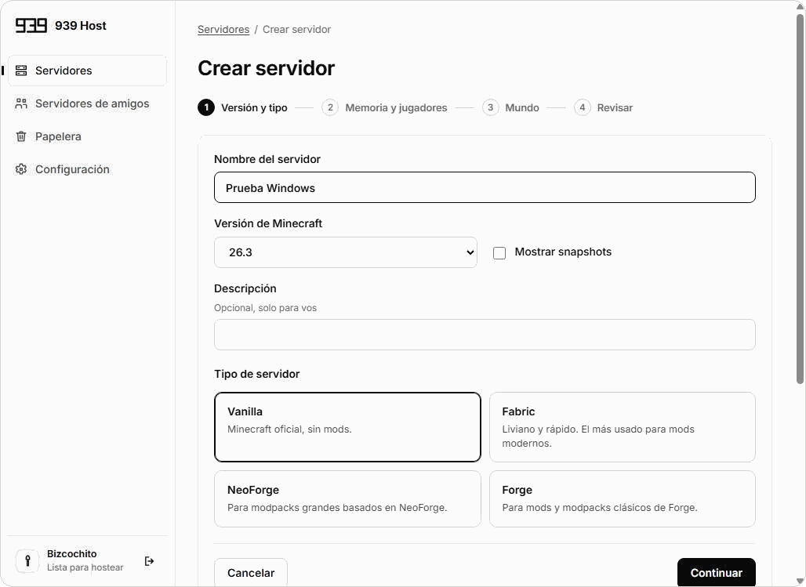
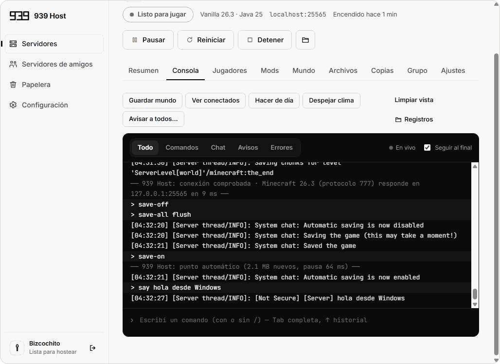
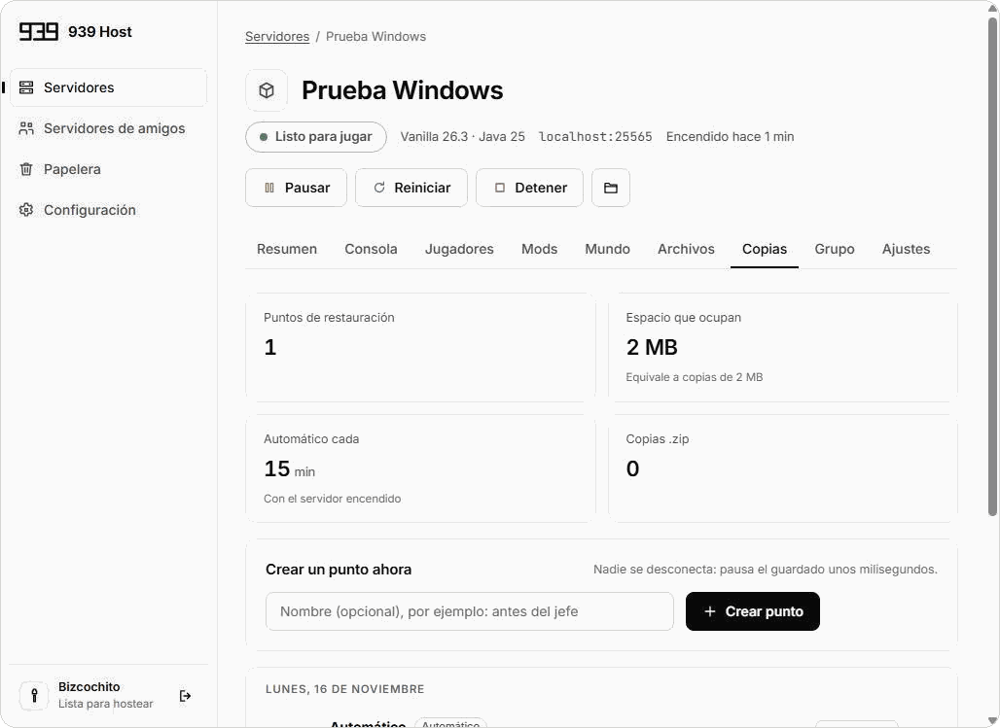
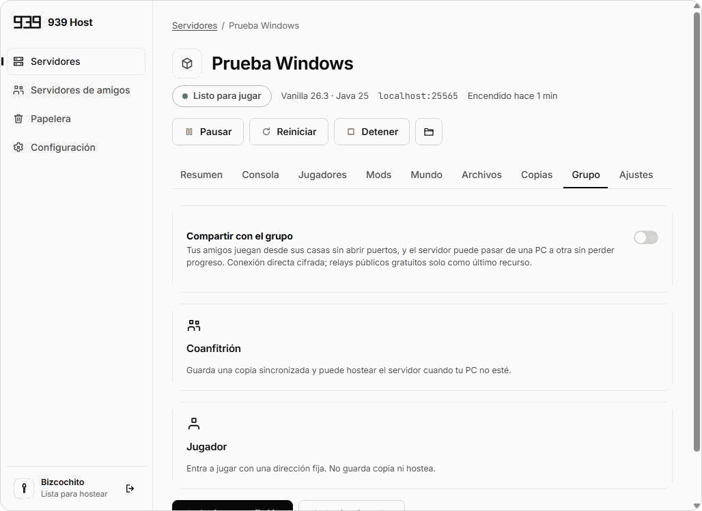
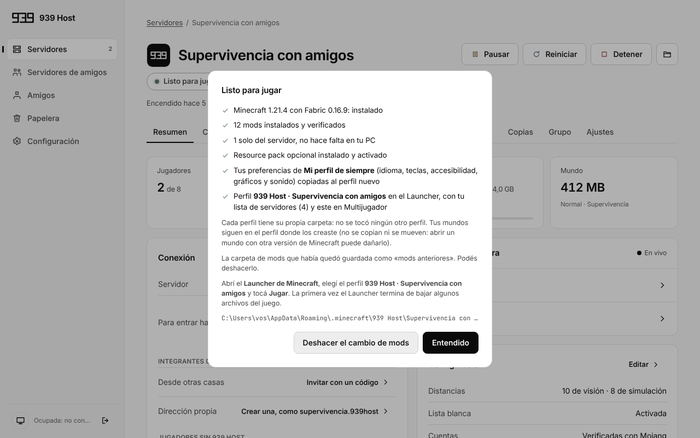
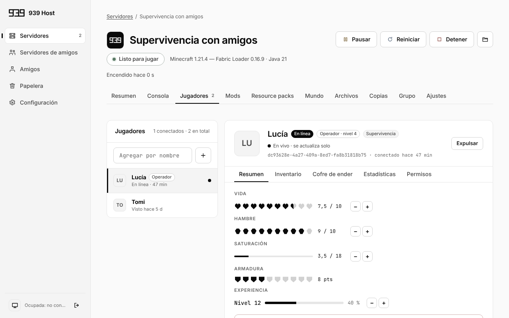
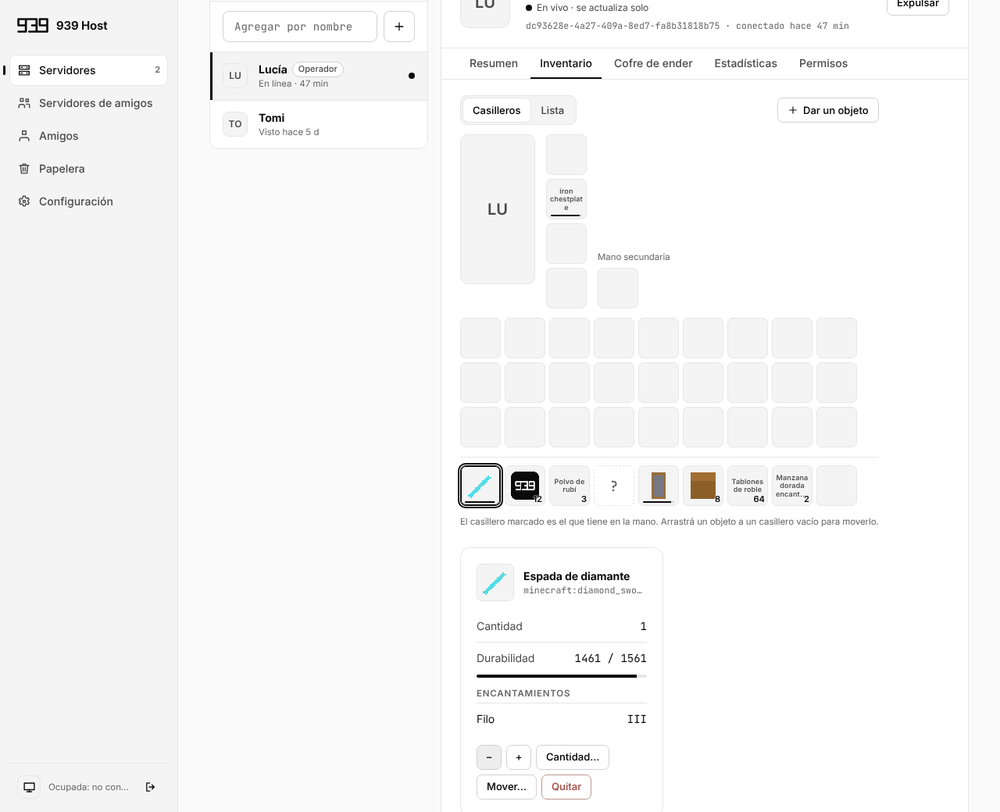
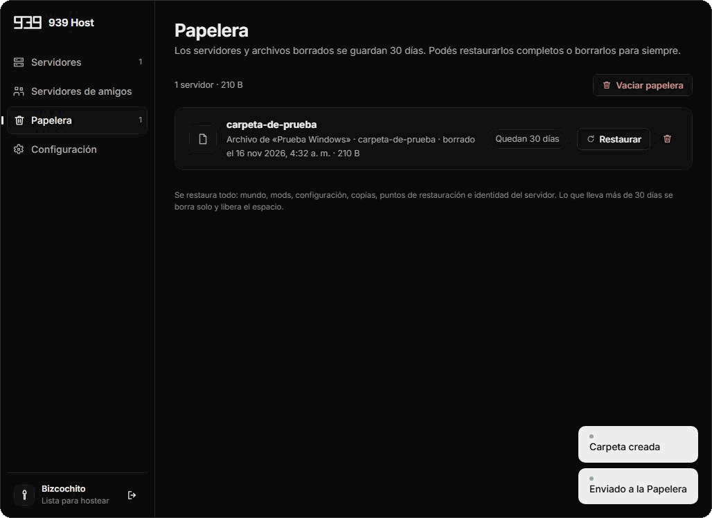
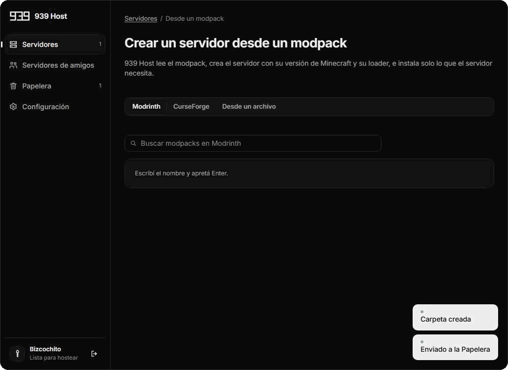
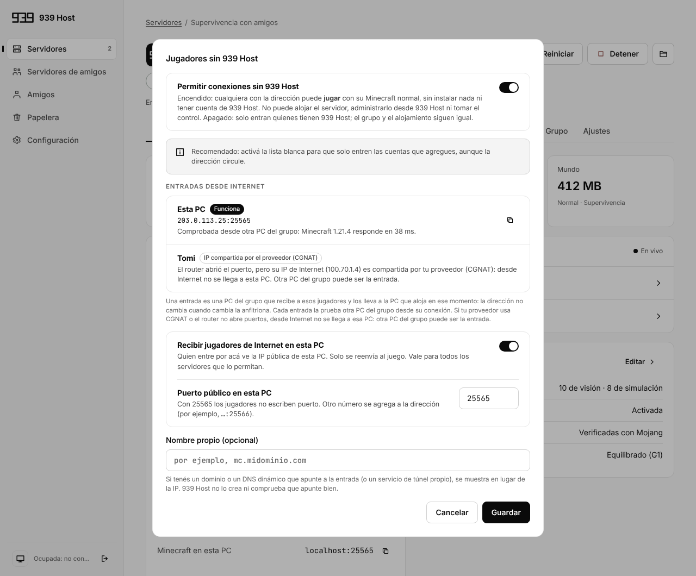

  <picture>
    <source media="(prefers-color-scheme: dark)" srcset="docs/img/portada-oscuro.svg">
    
  </picture>

  <a href="https://github.com/bouthex/939-host/releases/latest"><b>Descargar para Windows</b></a>
  &nbsp;&nbsp;·&nbsp;&nbsp;<a href="docs/MANUAL.md">Manual</a>
  &nbsp;&nbsp;·&nbsp;&nbsp;<a href="docs/PROBLEMAS.md">Ayuda</a>
  &nbsp;&nbsp;·&nbsp;&nbsp;<a href="CHANGELOG.md">Novedades</a>

 

Armar un servidor de Minecraft para jugar con amigos suele significar pagar un hosting, abrir puertos en
el router o depender de que una sola persona deje su PC prendida.

**939 Host** es una app de escritorio que lo resuelve: creás el servidor con un asistente, invitás a
tus amigos con un código y el servidor pasa a ser **del grupo**. Cualquiera de sus PCs puede alojarlo,
se pasa de una a otra sin perder progreso y todos entran siempre a la misma dirección.

  <picture>
    <source media="(prefers-color-scheme: dark)" srcset="docs/img/app-resumen-oscuro.png">
    
  </picture>

 

## Cómo funciona

  <picture>
    <source media="(prefers-color-scheme: dark)" srcset="docs/img/como-funciona-oscuro.svg">
    
  </picture>

Las PCs del grupo se conectan entre sí de forma directa y cifrada. La que aloja el servidor lo comparte;
las demás guardan una copia al día. Si querés pasárselo a otra, se hace sin perder nada, y con tres PCs o
más, si la anfitriona se apaga, otra lo retoma sola.

 

## Lo que hace

### Crear un servidor en minutos
Elegís la versión de Minecraft y el tipo (Vanilla, Fabric, Forge o NeoForge). 939 Host descarga el
servidor oficial y el Java que corresponde, y verifica cada archivo antes de usarlo.

### Administrarlo sin saber de servidores
Consola con comandos rápidos, jugadores y permisos, rendimiento en vivo y estados que dicen qué está
pasando. Las opciones avanzadas están, pero no estorban.

  <picture>
    <source media="(prefers-color-scheme: dark)" srcset="docs/img/app-consola-oscuro.png">
    
  </picture>

### Volver atrás cuando haga falta
Puntos de restauración automáticos del mundo, los mods y la configuración, sin desconectar a nadie.
Restaurar es elegir un momento y confirmar.

  <picture>
    <source media="(prefers-color-scheme: dark)" srcset="docs/img/app-copias-oscuro.png">
    
  </picture>

### Compartirlo con tu grupo
Invitaciones de un solo uso, roles (propietaria, coanfitrionas y jugadores) y cambios del grupo
firmados por la PC propietaria. Cada pedido para alojar espera la respuesta de quien aloja (nunca
se acepta solo), y pasar la propiedad es en dos pasos: la otra PC acepta y recién ahí cambia, sin
quedar nunca sin dueña ni con dos. Los nombres, el estado y quién aloja se ven en vivo.

  <picture>
    <source media="(prefers-color-scheme: dark)" srcset="docs/img/app-grupo-oscuro.png">
    
  </picture>

### Preparar el Minecraft de cada jugador
Un botón: **Preparar para jugar**. 939 Host instala la versión de Minecraft, el cargador (Fabric,
Forge o NeoForge) y los mods que necesita el servidor en una carpeta propia, crea el perfil en el
Launcher oficial y agrega el servidor a Multijugador. Si ya había una carpeta de mods, la guarda
como «mods anteriores» sin mezclar ni borrar nada (y se puede deshacer). La primera vez, el perfil
nuevo recibe una copia de tus preferencias del último perfil que usaste (idioma, teclas,
accesibilidad, gráficos y sonido) y de tu lista de servidores; tus mundos, perfiles, packs, capturas
y mods de siempre no se tocan. Funciona también en la PC de un amigo que solo juega.

  <picture>
    <source media="(prefers-color-scheme: dark)" srcset="docs/img/app-preparar-oscuro.png">
    
  </picture>

### Ver y cuidar a los jugadores
Cada jugador con su UUID, cuánto hace que está conectado, vida, hambre, saturación, experiencia,
inventario (también los objetos de mods, con su nombre, ícono y encantamientos) y las sesiones que
jugó, todo al día mientras juega. La PC propietaria administra aunque aloje otra PC: sube o baja
vida, hambre y nivel con − y +, cambia cantidades, da o quita objetos y **arrastra objetos de un
casillero a otro**; cada cambio se hace en el servidor real y se comprueba leyendo el inventario
otra vez.

  <picture>
    <source media="(prefers-color-scheme: dark)" srcset="docs/img/app-jugadores-oscuro.png">
    
  </picture>
  <picture>
    <source media="(prefers-color-scheme: dark)" srcset="docs/img/app-inventario-oscuro.png">
    
  </picture>

### Y además

| | |
|---|---|
| **Mods** | Modrinth con dependencias y actualizaciones. Mods de rendimiento elegidos para cada versión. |
| **Archivos** | Administrador integrado, también para servidores alojados en otra PC del grupo. El mundo queda protegido mientras está encendido. |
| **Papelera** | Lo que borrás se guarda 30 días y se restaura completo. |
| **Versiones** | Cambiar la versión de Minecraft o el loader (Vanilla, Fabric, Forge, NeoForge), con revisión de cada mod, copia previa verificada y opción de volver atrás. |
| **Chat** | Con amigos y grupos de amigos. Mensajes copiables; las direcciones, puertos, comandos e ids de mods se copian con un toque (nada se ejecuta solo). |
| **Espacio** | Liberar la caché de descargas sin tocar servidores, mundos ni copias. |
| **Modpacks** | Crear un servidor desde un `.mrpack` o un modpack de Modrinth. |
| **Resource packs** | Panel propio: buscar en Modrinth o subir un `.zip`. Obligatorio (lo envía el servidor al entrar; quien lo rechaza no entra) u opcional (lo instala «Preparar para jugar»). Los packs propios llegan a cada jugador por el grupo, sin publicarlos en internet. |
| **Otros launchers** | Exportar el perfil como `.mrpack` para Modrinth App, Prism Launcher y similares. |
| **Actualizaciones** | Automáticas desde las versiones oficiales: al abrir detecta, descarga, verifica la firma y el SHA-256, instala y reinicia. Si la versión nueva no abre, vuelve sola a la anterior. Los datos no se tocan. |

  
  

 

## Cómo se conectan los jugadores

**Con 939 Host** (recomendado): cada amigo se une al grupo con una invitación y entra por
`127.0.0.1:…`, una dirección que siempre lleva a la PC que esté alojando el servidor. No hace falta
abrir puertos: las PCs se conectan entre sí de forma directa y cifrada, y si no se puede, por un
relay que solo pasa datos cifrados.

**En la misma red** (misma casa): la pestaña Resumen muestra la IP real de la PC con su puerto y
un botón para copiarla; **Copiar todas las direcciones** junta solo las que funcionan, listas para
pegar en un chat.

**Sin 939 Host, por IP**: la propietaria puede activar **Permitir conexiones sin 939 Host**. Una o
más PCs del grupo que lo acepten hacen de *entrada*: piden al router que abra el puerto y llevan a
cada jugador hasta la PC que aloja en ese momento, así que la dirección no cambia cuando cambia la
anfitriona. Otra PC del grupo prueba cada entrada desde su propia conexión y la app muestra si
funciona.

  <picture>
    <source media="(prefers-color-scheme: dark)" srcset="docs/img/app-conexion-ip-oscuro.png">
    
  </picture>

> [!IMPORTANT]
> Entrar por IP solo sirve para **jugar**: no da acceso a la administración ni permiso para alojar.
> Necesita el modo online de Minecraft (cuentas verificadas) y conviene la lista blanca. Si tu
> proveedor de Internet comparte tu IP con otros clientes (CGNAT) o el router no abre puertos, desde
> Internet no se llega a esa PC: la app lo detecta y otra PC del grupo puede ser la entrada. Quien
> entra por una entrada ve la IP pública de esa PC. Detalles: [Conexión por IP](docs/DIRECCIONES-PUBLICAS.md).

 

## Compatibilidad

| | |
|---|---|
| **Minecraft** | Java Edition, versiones con servidor oficial de Mojang |
| **Servidores** | Vanilla, Fabric, Forge y NeoForge |
| **Mods** | Modrinth (con dependencias y versiones compatibles), CurseForge con clave propia y archivos `.jar` agregados a mano |
| **Modpacks** | `.mrpack` y modpacks de Modrinth |
| **Para jugar** | Launcher oficial de Minecraft (también el de Microsoft Store) u otros launchers con `.mrpack` |

 

## Estado del proyecto

La versión publicada es la que figura arriba, en [Releases](https://github.com/bouthex/939-host/releases/latest).
El desarrollo sigue en la rama [`rediseno-v3`](https://github.com/bouthex/939-host/tree/rediseno-v3); lo que
todavía no está publicado se anota en el [registro de cambios](CHANGELOG.md).

Cada versión se prueba en Windows reales en la integración continua: servidores de Minecraft reales,
dos PCs de Windows hablándose por la red P2P, un cliente real de Minecraft que entra a jugar (Vanilla
1.20.4 y 26.2, Fabric 26.3), instalación encima de la versión anterior y actualización con vuelta
atrás. Lo que depende de dos casas con redes distintas (routers, CGNAT, entrada desde Internet) se
prueba además a mano entre PCs reales.

**Necesita configuración aparte:** CurseForge funciona solo con una clave de su API oficial
([cómo conseguirla](docs/MANUAL.md#curseforge)). Lo que todavía no hace está en
[Limitaciones](docs/LIMITACIONES.md).

> [!NOTE]
> 939 Host **no está firmado digitalmente** todavía: Windows puede mostrar un aviso al abrirlo, y con
> Smart App Control activado lo bloquea. Se pidió la firma gratuita de SignPath Foundation. No
> recomendamos desactivar protecciones de Windows.

 

## Instalar

| | |
|---|---|
| **Sistema** | Windows 10 u 11 de 64 bits, con Microsoft Edge WebView2 (ya incluido en Windows 11) |
| **Para jugar** | Minecraft: Java Edition con una cuenta oficial |
| **Java** | No hace falta: 939 Host baja el que necesita cada servidor |

1. Descargá **`939Host-<versión>-instalador.exe`** desde
   [Releases](https://github.com/bouthex/939-host/releases/latest). También hay una versión
   portable y los hashes SHA-256 para verificar las descargas.
2. Ejecutalo. Se instala para tu usuario, sin permisos de administrador.
3. Abrí 939 Host, tocá **Crear servidor** y seguí el asistente.
4. Cuando termine, tocá **Iniciar**. Para sumar amigos, andá a la pestaña **Grupo**.

Verificación de descargas, actualización y desinstalación: [Instalación](docs/INSTALACION.md).

 

## La primera vez

1. **Creá el servidor**: *Crear servidor* → nombre, versión y tipo. 939 Host baja todo lo necesario.
2. **Encendelo**: *Iniciar*. El estado dice «Listo para jugar» cuando se puede entrar.
3. **Prepará tu Minecraft**: en el resumen del servidor, *Preparar para jugar*. Abrí el Launcher,
   elegí el perfil «939 Host · …» y jugá.
4. **Sumá a tus amigos**: pestaña *Grupo* → *Invitar*. Tu amigo instala 939 Host, pega el código en
   *Servidores de amigos → Unirme*, toca *Preparar para jugar* y entra por la dirección que le aparece.
5. **Opcional**: activá la conexión por IP para quien no tenga 939 Host.

 

## Seguridad y permisos

- **Roles**: propietaria (decide todo), coanfitrionas (pueden alojar y guardan una copia) y
  jugadores (solo juegan). Los cambios del grupo los firma la PC propietaria.
- **Lo delicado se controla en la app, no solo en la pantalla**: cambiar datos de jugadores,
  permitir conexiones sin 939 Host o quitar a alguien del grupo se comprueba en el programa.
- **Sin cuentas ni telemetría**. 939 Host nunca pide ni guarda la contraseña de Microsoft.
- **Descargas verificadas** por su hash (Mojang, Fabric, Forge, NeoForge, Modrinth y Java).
- **Actualizaciones firmadas**: solo se instalan las versiones oficiales firmadas con la clave del
  proyecto (la app trae la parte pública). Una compilación de prueba, un archivo cambiado o una
  dirección distinta se rechazan. Detalles: [Actualizaciones](docs/ACTUALIZACIONES.md).
- **Tu Minecraft queda a salvo**: cada servidor usa su propia carpeta de juego y los mods que había
  se guardan aparte; el archivo de perfiles del Launcher se copia antes de tocarlo.
- Más: [Privacidad](PRIVACY.md) · [Seguridad](SECURITY.md) · [Limitaciones](docs/LIMITACIONES.md).

 

## Preguntas frecuentes

<b>¿Tengo que dejar mi PC prendida para que mis amigos jueguen?</b>

No necesariamente. Cualquier PC del grupo invitada como coanfitriona puede alojar el servidor; con
tres PCs o más, si la que aloja se apaga, otra lo retoma sola.

<b>¿Hace falta abrir puertos en el router?</b>

No, para jugar con 939 Host. Solo la conexión por IP (sin 939 Host) necesita que el router de la
PC de entrada abra un puerto, y 939 Host intenta hacerlo solo.

<b>¿Mis amigos necesitan 939 Host?</b>

Para unirse al grupo y prepararse el Minecraft con un botón, sí. Si la propietaria lo permite,
también pueden entrar por IP con su Minecraft normal.

<b>¿Cuesta algo?</b>

No. No hay servidores pagos ni suscripciones: el servidor corre en las PCs del grupo.

<b>¿Toca mi Minecraft de siempre?</b>

No mezcla nada: cada servidor tiene su carpeta y su perfil «939 Host · …» en el Launcher. Tus
perfiles y mods de siempre quedan como estaban.

<b>¿Cómo se actualiza?</b>

Solo, desde la 1.3.0. Al abrir (y cada 6 horas) 939 Host busca la última versión oficial; si hay una,
la descarga, comprueba su firma y su SHA-256, la instala y vuelve a abrir. Si la versión nueva no
arranca, vuelve sola a la anterior. Servidores, mundos, mods, grupos, perfil y configuración quedan
como estaban. Nunca se actualiza con un servidor encendido; si estás usando la app, aparece un aviso
«Actualizar ahora». También en Configuración → Actualizaciones → *Buscar actualizaciones*.

Si tenés la 0.9.0 o una versión de prueba anterior (1.1.0, 1.2.0), instalá la 1.3.0 **una vez a mano**
encima de la que tengas (se conservan todos los datos): esas versiones confían en una clave de
publicación anterior. Desde la 1.3.0, las siguientes llegan solas.

<b>Windows me muestra un aviso al abrirlo</b>

939 Host todavía no está firmado digitalmente. Podés verificar la descarga con su SHA-256
([Instalación](docs/INSTALACION.md)). No recomendamos desactivar protecciones de Windows.

 

## Documentación y ayuda

- **[Manual](docs/MANUAL.md)**: cómo usar cada parte de la app.
- **[Solución de problemas](docs/PROBLEMAS.md)**: errores comunes.
- **[Reportar un error o pedir algo](https://github.com/bouthex/939-host/issues/new/choose)**: con
  formularios para cada caso.
- **Seguridad**: las vulnerabilidades se reportan en privado, como explica [SECURITY.md](SECURITY.md).
- **[Privacidad](PRIVACY.md)**: sin telemetría ni cuentas.
- **[Para desarrolladores](docs/README.md)**: compilar, arquitectura y pruebas.

 

  <picture>
    <source media="(prefers-color-scheme: dark)" srcset="docs/img/939-oscuro.svg">
    
  </picture>
   
  Creado por Archimak y Bout · Licencia <a href="LICENSE">MIT</a>
   
  939 Host no es un producto oficial de Minecraft. No está aprobado por Mojang ni Microsoft, ni asociado con ellos. Minecraft es una marca de Mojang AB.

