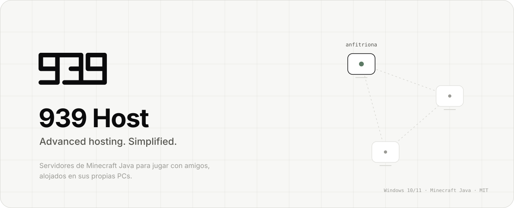
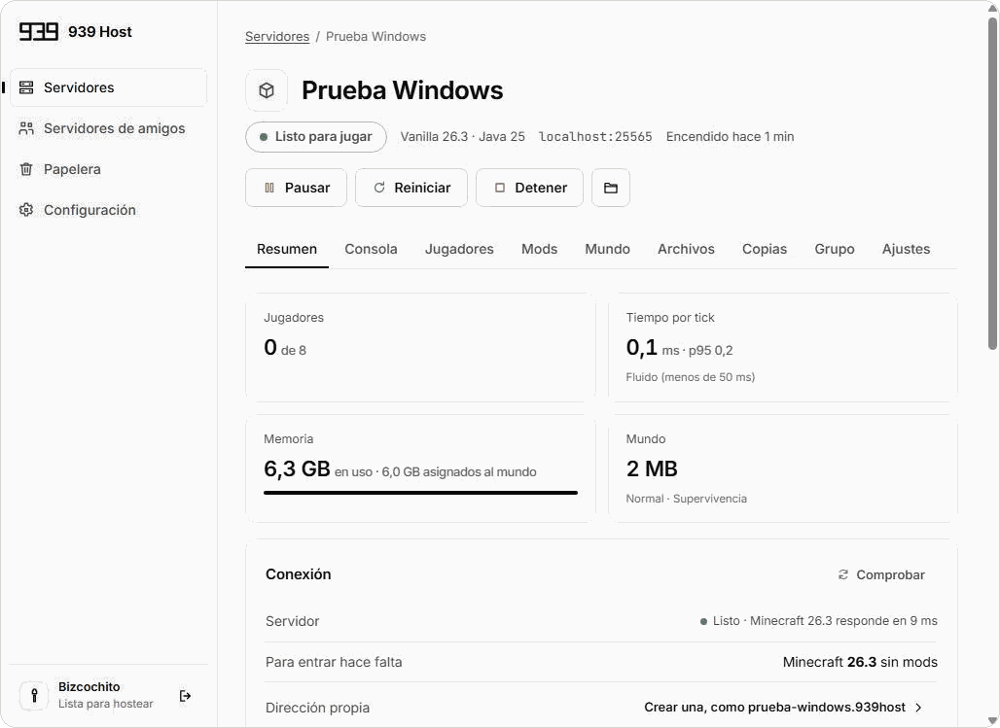
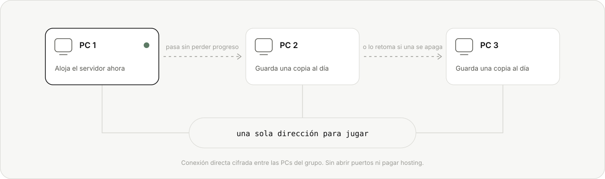

  <picture>
    <source media="(prefers-color-scheme: dark)" srcset="docs/img/portada-oscuro.svg">
    
  </picture>

  <a href="https://github.com/bouthex/939-host/releases/latest"><b>Descargar para Windows</b></a>
  &nbsp;&nbsp;·&nbsp;&nbsp;<a href="docs/MANUAL.md">Manual</a>
  &nbsp;&nbsp;·&nbsp;&nbsp;<a href="docs/PROBLEMAS.md">Ayuda</a>
  &nbsp;&nbsp;·&nbsp;&nbsp;<a href="CHANGELOG.md">Novedades</a>

 

Armar un servidor de Minecraft para jugar con amigos suele significar pagar un hosting, abrir puertos en
el router o depender de que una sola persona deje su PC prendida.

**939 Host** es una app de escritorio que lo resuelve: creás el servidor con un asistente, invitás a
tus amigos con un código y el servidor pasa a ser **del grupo**. Cualquiera de sus PCs puede alojarlo,
se pasa de una a otra sin perder progreso y todos entran siempre a la misma dirección.

  <picture>
    <source media="(prefers-color-scheme: dark)" srcset="docs/img/app-resumen-oscuro.png">
    
  </picture>

 

## Cómo funciona

  <picture>
    <source media="(prefers-color-scheme: dark)" srcset="docs/img/como-funciona-oscuro.svg">
    
  </picture>

Las PCs del grupo se conectan entre sí de forma directa y cifrada. La que aloja el servidor lo comparte;
las demás guardan una copia al día. Si querés pasárselo a otra, se hace sin perder nada, y con tres PCs o
más, si la anfitriona se apaga, otra lo retoma sola.

 

## Lo que hace

### Crear un servidor en minutos
Elegís la versión de Minecraft y el tipo (Vanilla, Fabric, Forge o NeoForge). 939 Host descarga el
servidor oficial y el Java que corresponde, y verifica cada archivo antes de usarlo.

### Administrarlo sin saber de servidores
Consola con comandos rápidos, jugadores y permisos, rendimiento en vivo y estados que dicen qué está
pasando. Las opciones avanzadas están, pero no estorban.

  <picture>
    <source media="(prefers-color-scheme: dark)" srcset="docs/img/app-consola-oscuro.png">
    
  </picture>

### Volver atrás cuando haga falta
Puntos de restauración automáticos del mundo, los mods y la configuración, sin desconectar a nadie.
Restaurar es elegir un momento y confirmar.

  <picture>
    <source media="(prefers-color-scheme: dark)" srcset="docs/img/app-copias-oscuro.png">
    
  </picture>

### Compartirlo con tu grupo
Invitaciones de un solo uso, roles (propietaria, coanfitrionas y jugadores) y cambios del grupo
firmados por la PC propietaria.

  <picture>
    <source media="(prefers-color-scheme: dark)" srcset="docs/img/app-grupo-oscuro.png">
    
  </picture>

### Y además

| | |
|---|---|
| **Mods** | Modrinth con dependencias y actualizaciones. Mods de rendimiento elegidos para cada versión. |
| **Archivos** | Administrador integrado, también para servidores alojados en otra PC del grupo. El mundo queda protegido mientras está encendido. |
| **Papelera** | Lo que borrás se guarda 30 días y se restaura completo. |
| **Versiones** | Cambiar la versión de Minecraft con copia previa verificada y opción de volver atrás. |
| **Modpacks** | Crear un servidor desde un `.mrpack` o un modpack de Modrinth. |
| **Jugadores** | Perfil de mods (`.mrpack`) para que cada uno prepare su Minecraft. |

 

## Estado del proyecto

La versión publicada es la **0.9.0**. La rama
[`rediseno-v3`](https://github.com/bouthex/939-host/tree/rediseno-v3) tiene la próxima versión, probada en
Windows reales (servidores, dos PCs en lugares distintos y un cliente real de Minecraft), pero
**todavía no está publicada**. Las capturas de esta página son de esa versión.

En la 0.9.0 ya están: crear y administrar servidores, mods de Modrinth, puntos de restauración y
compartir entre PCs. Todo lo demás de esta página llega con la próxima versión.

**Necesita configuración aparte:** CurseForge funciona solo con una clave de su API oficial
([cómo conseguirla](docs/MANUAL.md#curseforge)). Lo que todavía no hace está en
[Limitaciones](docs/LIMITACIONES.md).

> [!NOTE]
> 939 Host está en desarrollo y puede tener errores. La versión 0.9.0 **no está firmada
> digitalmente**: Windows puede mostrar un aviso al abrirla, y con Smart App Control activado la
> bloquea. No recomendamos desactivar protecciones de Windows.

 

## Instalar

| | |
|---|---|
| **Sistema** | Windows 10 u 11 de 64 bits, con Microsoft Edge WebView2 (ya incluido en Windows 11) |
| **Para jugar** | Minecraft: Java Edition con una cuenta oficial |
| **Java** | No hace falta: 939 Host baja el que necesita cada servidor |

1. Descargá **`939Host-0.9.0-instalador.exe`** desde
   [Releases](https://github.com/bouthex/939-host/releases/latest). También hay una versión
   portable y los hashes SHA-256 para verificar las descargas.
2. Ejecutalo. Se instala para tu usuario, sin permisos de administrador.
3. Abrí 939 Host, tocá **Crear servidor** y seguí el asistente.
4. Cuando termine, tocá **Iniciar**. Para sumar amigos, andá a la pestaña **Grupo**.

Verificación de descargas, actualización y desinstalación: [Instalación](docs/INSTALACION.md).

 

## Documentación y ayuda

- **[Manual](docs/MANUAL.md)**: cómo usar cada parte de la app.
- **[Solución de problemas](docs/PROBLEMAS.md)**: errores comunes.
- **[Reportar un error o pedir algo](https://github.com/bouthex/939-host/issues/new/choose)**: con
  formularios para cada caso.
- **Seguridad**: las vulnerabilidades se reportan en privado, como explica [SECURITY.md](SECURITY.md).
- **[Privacidad](PRIVACY.md)**: sin telemetría ni cuentas.
- **[Para desarrolladores](docs/README.md)**: compilar, arquitectura y pruebas.

 

  <picture>
    <source media="(prefers-color-scheme: dark)" srcset="docs/img/939-oscuro.svg">
    
  </picture>
   
  Creado por Archimak y Bout · Licencia <a href="LICENSE">MIT</a>
   
  939 Host no es un producto oficial de Minecraft. No está aprobado por Mojang ni Microsoft, ni asociado con ellos. Minecraft es una marca de Mojang AB.

